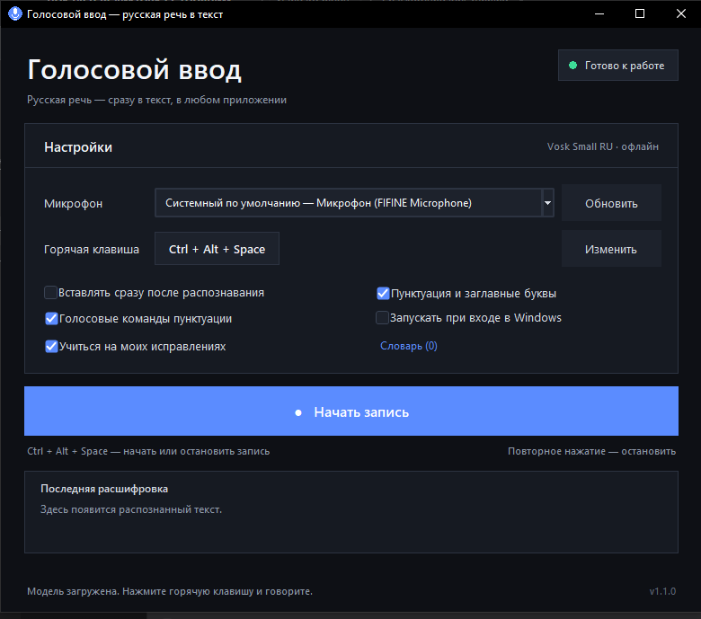

# Голосовой ввод

Локальная программа для Windows: нажимаете горячую клавишу, говорите по-русски,
нажимаете ещё раз — распознанный текст можно сразу вставить в любое приложение,
где стоит курсор.

[](https://github.com/iliatty/voice-input-ru/releases/latest)



## Что умеет

- распознаёт русскую речь **офлайн**, без API-ключей и интернета;
- показывает маленькое плавающее окно с таймером, уровнем микрофона и живым текстом;
- вставляет текст в то окно, которое было активно до начала записи;
- позволяет проверить и поправить текст перед вставкой;
- умеет вставлять сразу после остановки записи;
- **сворачивается в трей**: закрытие окна не завершает программу;
- **учится на ваших исправлениях** и подставляет исправленные слова в следующих
  расшифровках;
- поддерживает голосовые команды пунктуации;
- запоминает микрофон и горячую клавишу;
- запускается вместе с Windows (по желанию).

## Установка

### Вариант 1 — готовый релиз (рекомендуется)

1. Откройте страницу релизов:
   **[github.com/iliatty/voice-input-ru/releases](https://github.com/iliatty/voice-input-ru/releases/latest)**.
2. Скачайте `VoiceInputRU-1.1.0-win64.zip`.
3. Распакуйте архив в любую папку, например `C:\Tools\VoiceInputRU`.
4. Запустите `VoiceInputRU.exe`.

Установщик не нужен: программа портативная, не требует прав администратора и не
прописывает файлы в системные папки. Модель уже лежит в архиве, интернет при первом
запуске не нужен.

> Не перемещайте `VoiceInputRU.exe` отдельно от папки: рядом должны оставаться
> `_internal` и `models`. Переносите всю папку `VoiceInputRU`.

Если Windows SmartScreen покажет предупреждение: **«Подробнее» → «Выполнить в любом
случае»** — exe не подписан цифровой подписью.

### Вариант 2 — из исходников

Нужен Python 3.10+ (проверялось на 3.12, Windows 10/11 x64).

```bat
install.bat
run.bat
```

`install.bat` поставит зависимости в локальную папку `vendor` (venv не нужен).
`run.bat` запустит приложение без консольного окна. Для диагностики есть
`run_console.bat`. Если модели нет, приложение предложит скачать её кнопкой
«Скачать 46 МБ».

### Удаление

1. Выберите **«Выход»** в меню иконки в трее.
2. Запустите `uninstall.bat` из папки программы — он удалит автозапуск, настройки,
   журнал, словарь самообучения и скачанные модели.
3. Удалите папку программы вручную.

`uninstall.bat` входит в релизный архив.

## Быстрый старт

1. Выберите микрофон, при необходимости назначьте свою горячую клавишу.
2. Поставьте курсор в нужное место (Word, Блокнот, браузер, мессенджер).
3. Нажмите **Ctrl + Alt + Space**, продиктуйте текст.
4. Нажмите **Ctrl + Alt + Space** ещё раз.
5. Проверьте текст в окне и нажмите **Вставить** (или `Ctrl+Enter`).

## Трей и фоновая работа

- Кнопка закрытия окна (`×`) **скрывает программу в трей**, а не завершает её.
- Глобальная горячая клавиша работает, пока окно скрыто.
- Меню иконки в трее:
  - **Открыть** — показать окно (двойной клик по иконке делает то же самое);
  - **Записать / остановить** — управлять записью, не открывая окно;
  - **Выход** — полностью завершить программу.
- При автозапуске окно сразу скрывается в трей.
- Если трей недоступен, закрытие завершает программу как обычно.

## Автообучение

Включите **«Учиться на моих исправлениях»** в настройках. После распознавания
исправьте ошибки в окне предпросмотра и нажмите **«Вставить»**. Программа сравнит
исходный и исправленный текст и запомнит устойчивые замены слов, например:

```text
«хат» → «чат»
«новая почта» → «новый имейл»
```

В следующих расшифровках эти замены применяются автоматически. Кнопка
**«Словарь (N)»** показывает все запомненные пары; их можно удалить выборочно или
очистить целиком.

Важно: это **адаптация словаря по вашим правкам**, а не переобучение нейросети
Vosk. Полноценное дообучение акустической модели требует датасета, размеченных
аудиозаписей и отдельного пайплайна обучения; «на лету» в домашних условиях оно
не делается. Замена слов решает практическую задачу — имена, термины, сленг и
частые ошибки распознавания.

## Горячие клавиши

| Действие | Клавиши |
|---|---|
| Начать / остановить запись | `Ctrl + Alt + Space` (настраивается) |
| Остановить и распознать | кнопка **Остановить** или повторное нажатие горячей клавиши |
| Вставить текст из окна предпросмотра | `Ctrl+Enter` или кнопка **Вставить** |
| Закрыть / отменить | `Esc`, `Отмена` или `×` |

Горячую клавишу можно изменить: **Настройки → Горячая клавиша → Изменить**.
Нужен хотя бы один модификатор (`Ctrl`, `Alt`, `Shift`, `Win`) и одна клавиша.
Если комбинация занята другой программой, приложение сообщит об этом.

## Настройки

- **Микрофон** — список устройств ввода. «Системный по умолчанию» следует за
  настройкой Windows. После подключения нового микрофона нажмите «Обновить».
- **Горячая клавиша** — глобальная, работает даже когда окно скрыто в трее.
- **Вставлять сразу после распознавания** — если включено, окно предпросмотра не
  показывается: текст сразу вставляется в активное окно.
- **Пунктуация и заглавные буквы** — автоматически делает первую букву заглавной,
  ставит точку в конце и наводит порядок в пробелах.
- **Голосовые команды пунктуации** — распознаёт команды вроде «запятая» и
  «новая строка» (см. ниже).
- **Учиться на моих исправлениях** — включает словарь самообучения.
- **Запускать при входе в Windows** — добавляет программу в автозапуск текущего
  пользователя. При автозапуске окно сразу скрывается в трей.

## Голосовые команды

Скажите вслух:

| Команда | Результат |
|---|---|
| `запятая` | `,` |
| `точка` (в конце фразы) | `.` |
| `вопросительный знак` | `?` |
| `восклицательный знак` | `!` |
| `двоеточие` | `:` |
| `точка с запятой` | `;` |
| `тире` | ` — ` |
| `дефис` | `-` |
| `новая строка` | перенос строки |
| `новый абзац` | пустая строка |
| `открыть кавычки` / `закрыть кавычки` | `«` / `»` |
| `открыть скобку` / `закрыть скобку` | `(` / `)` |

Команды работают, только если включена галочка «Голосовые команды пунктуации».
Слово «точка» превращается в знак только в самом конце фразы, чтобы не ломать
выражения вроде «точка зрения».

## Как работает вставка

Перед началом записи программа запоминает активное окно. После распознавания она
возвращает фокус этому окну и отправляет `Ctrl+V`. Текст на время вставки
помещается в буфер обмена и **остаётся там** — его можно вставить ещё раз вручную.

Если окно закрылось, было запущено от администратора или не принимает `Ctrl+V`,
текст остаётся в буфере обмена, а программа покажет подсказку. Вставьте его вручную
через `Ctrl+V` (в некоторых терминалах — `Ctrl+Shift+V`).

## Приватность

- Аудио обрабатывается локально моделью Vosk и **никуда не отправляется**.
- Приложению не нужны аккаунты, API-ключи и интернет.
- В журнал не записывается распознанный текст; там только технические события.
- История расшифровок хранится только в памяти до закрытия программы.
- Словарь самообучения лежит локально в `%APPDATA%\VoiceInputRU\learning.json` и
  никуда не отправляется.

## Где лежат файлы

- Настройки, журнал и словарь: `%APPDATA%\VoiceInputRU\`
- Модель: `models\vosk-model-small-ru-0.22` рядом с программой
- Исходный код: `voice_input\`
- Тесты: `tests\`
- Сборка exe: `build_exe.bat`
- Удаление: `uninstall.bat`

## Решение проблем

**«Модель не найдена».** Проверьте, что рядом с `VoiceInputRU.exe` есть папка
`models\vosk-model-small-ru-0.22` с подпапками `am`, `conf`, `graph`, `ivector`.
Можно нажать «Указать папку» и выбрать её вручную или скачать модель заново
кнопкой «Скачать 46 МБ».

**«Не удалось открыть микрофон».** Закройте приложения, которые могут занимать
микрофон (мессенджеры, браузеры, запись экрана), выберите другое устройство и
нажмите «Обновить».

**Горячая клавиша не срабатывает.** Комбинацию могла занять другая программа.
Назначьте другую. В играх и приложениях с античитом глобальный перехват клавиатуры
может блокироваться. Для вставки в приложения, запущенные от администратора,
запустите «Голосовой ввод» тоже от администратора.

**Вставка не произошла, но текст есть.** Он остался в буфере обмена. Перейдите в
нужное окно и нажмите `Ctrl+V`.

**Закрыл окно, а программа работает.** Так задумано: она свёрнута в трей. Чтобы
завершить, выберите **«Выход»** в меню иконки в трее.

**Программа не запускается.** Посмотрите журнал:
`%APPDATA%\VoiceInputRU\voice_input.log`. Если exe скачан из интернета, Windows
SmartScreen может попросить «Подробнее → Выполнить в любом случае» — файл не
подписан цифровой подписью.

## Тесты и сборка

Юнит-тесты (25 тестов):

```bat
run_tests.bat
```

Сборка exe (PyInstaller):

```bat
build_exe.bat
```

Готовая папка появится в `dist\VoiceInputRU`. Модель копируется туда автоматически;
если её нет, скрипт скачает её через `tools\download_model.py`.

## Технические детали

- Python 3.12, Tkinter, SoundDevice/PortAudio, NumPy;
- Vosk `vosk-model-small-ru-0.22` — офлайн-распознавание русской речи;
- `pystray` + Pillow — иконка и меню в системном трее;
- глобальные горячие клавиши — библиотека `keyboard` (низкоуровневый hook Windows);
- вставка — буфер обмена + `Ctrl+V` через Win32 `SendInput`;
- загрузка модели — в фоновом потоке, чтобы интерфейс не замирал;
- аудио ресемплится в 16 кГц, если микрофон не поддерживает этот режим напрямую.

## Ограничения

- Модель small не идеальна: имена, термины и шум могут распознаваться с ошибками.
  Текст всегда можно поправить в окне предпросмотра.
- Пунктуация эвристическая: Vosk не расставляет знаки сам.
- Автообучение работает на уровне замен слов, а не переобучает акустическую модель.
- Горячие клавиши и вставка используют Win32 API, поэтому программа предназначена
  для Windows.
- Программа не подписана сертификатом; при первом запуске возможен SmartScreen.
